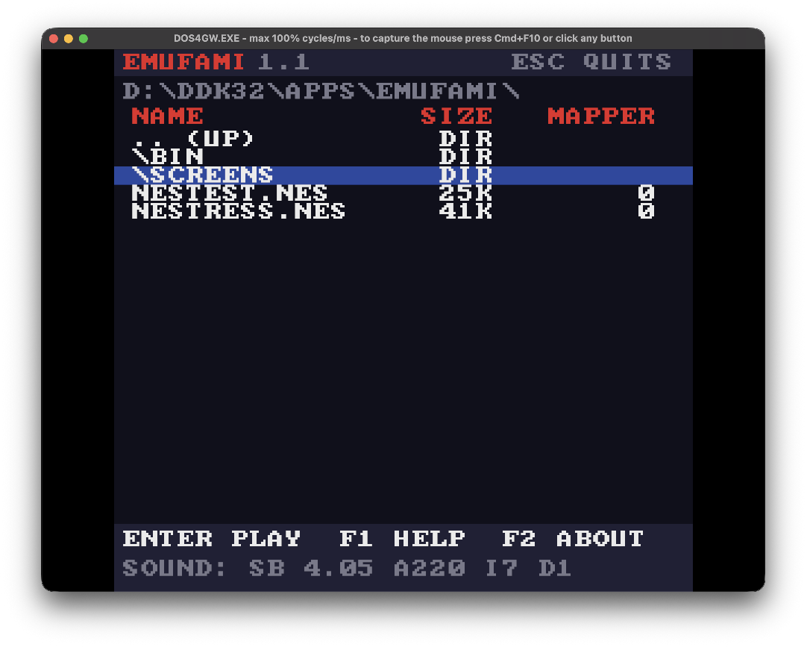
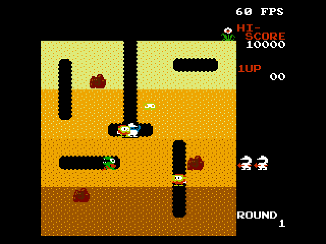
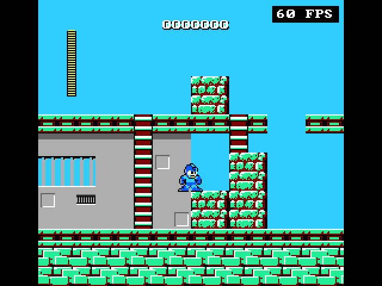
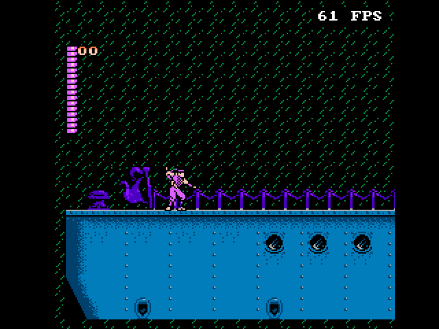
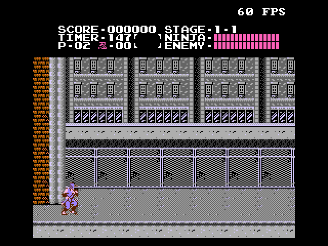

# EMUFAMI v1.3

An educational NES emulator for DOS.

The whole emulator is written using plain, readable Pascal syntax: the 6502, the PPU, the APU and the mappers. Compatible with **TMT Pascal 3.90**, **Free Pascal 3.2** (go32v2) or **Borland Pascal 7.0** (16-bit protected mode). EMUFAMI requires a VGA adapter to run and it runs under VGA 256x240 or TEXT 640x480 video modes.

This is a part of a fully functional Pascal-based NES emulator running under DOS that is under development. The emulator is written completely from scratch, no external dependencies needed.

**NOTE:** 
* The owners of **TMT Pascal** have removed the download of TMT Pascal 3.9 for DOS from their website. Alternate link: https://www.bttr-software.de/links/.
* **Free Pascal for DOS** (go32v2) can be downloaded at: https://www.freepascal.org/down/i386/go32v2.html
* **Borland Pascal 7.0** can be downloaded at https://winworldpc.com/product/borland-pascal/7x
* **EMUFAMI** currently supports eight mappers, keyboard control only and Sound Blaster, nothing else.

## Screenshots

|GUI|
|---|
| |

| Super Mario Bros. | The Legend of Zelda | Contra |
|---|---|---|
|  |  |  |

| Donkey Kong 3 | Galaga | Mappy |
|---|---|---|
|  |  |  |

| Adventure Island | nestest | NEStress |
|---|---|---|
|  |   |  |

### Text mode

| Dig Dug | Mega Man |
|---|---|
|  |  |

| The Legend of Kage | Ninja Gaiden |
|---|---|
|  |  |

## Running

```
FAMI_T            Open ROM picker
FAMI_T ROM.NES    launch ROM.NES, Esc quits to DOS
FAMI_T /TEXT      games in VGA text mode
```

`FAMI_F` and `FAMI_B` (the FPC and BP7 builds) take the same arguments.

### Controls

| ROM picker | |
|---|---|
| Up, Down, PgUp, PgDn, Home, End | choose |
| A-Z | quick jump |
| Enter | open |
| Backspace | parent folder |
| F1| short help |
| F2 | about |
| F3 | sound on/off |
| F4 | frames per second on/off |
| F6 | audio at 22 or 11 kHz |
| Esc | quit |

| In-game | Pad 1 | Pad 2 |
|---|---|---|
| D-pad | arrows | W S A D |
| A | X | H |
| B | Z | G |
| Select | Right Shift | T |
| Start | Enter | Y |

**P** pauses, **F1** resets, **F5** switches between VGA and text mode, **Esc** closes active ROM.

A game's battery RAM is kept in `NAME.SAV` beside `NAME.NES`. There are no save states.

## System Requirements

- **CPU:** I'm not sure about this. Tested under DOSBox-Staging and DOSBox-X only.
  At DOSBox-Staging's default speed for protected mode (60000 cycles), Super Mario Bros. runs at about 48 frames per second (TMT build), 56 (FPC) and 33 (BP7); with `cycles = max` all three reach the full 60.
- **Video:** VGA only, tweaked mode 256x240 @ 60 Hz, or text mode at 640x480 @ 60 Hz.
- **Sound:** Sound Blaster (1.x, 2.0, Pro, 16, AWE).
- **Memory:** 4 MB.

## Mappers

| No. | Board | No. | Board |
|---|---|---|---|
| 0 | NROM  | 1 | MMC1 |
| 2 | UxROM | 3 | CNROM |
| 4 | MMC3 | 7 | AxROM |
| 11 | Color Dreams | 66 | GxROM |

Supports NTSC, PAL timings.

## Building

```
MAKE               all three below
MAKE tmt           BIN\FAMI_T.EXE (TMT Pascal)
MAKE fpc           BIN\FAMI_F.EXE (Free Pascal - go32v2)
MAKE bp            BIN\FAMI_B.EXE (Borland Pascal 7.0 - protected mode)
MAKE clean         clean all binaries and intermediate files for a fresh build.
BUILD              all three from scratch
```

To specify your Pascal compiler use the following example: `MAKE -DBPC=D:\BP\BIN\BPC.EXE bp` (also `TMTPC`, `FPC`). The BP7 build needs `RTM.EXE` and `DPMI16BI.OVL` (from BP7's `BIN` folder) beside it or on the `PATH`.

The emulator has small footprints. TMT-compiled binary is about 91KB (92,922 bytes), the FPC one is roughly 98KB (99,840 bytes) and the BP7 one about 98KB (100,608 bytes).

## ROMs

- `nestest.nes`: kevtris's nestest, which checks the CPU's instructions, official and unofficial. Run it, press Start, and read the screen.
- `nestress.nes`: FluBBa's NEStress, with PPU, sound, CPU and controller tests and a stress test of them all.

Both belong to their corresponding owners. No other ROMs included.

## TODOs
- Support more mappers.
- Improve the GUI.

---

by Trinh D.D. Nguyen, 2026.
