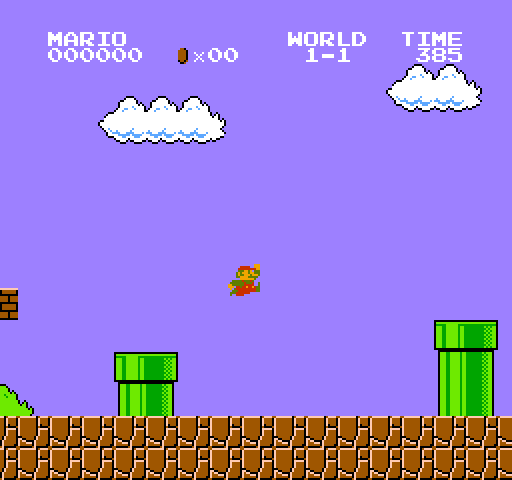
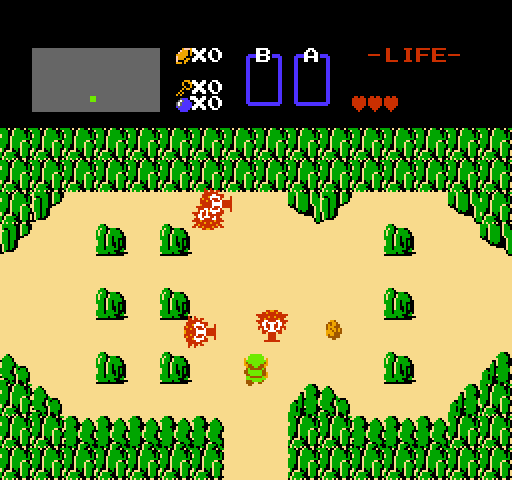
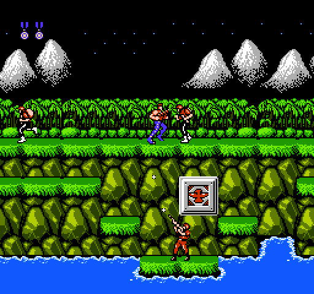
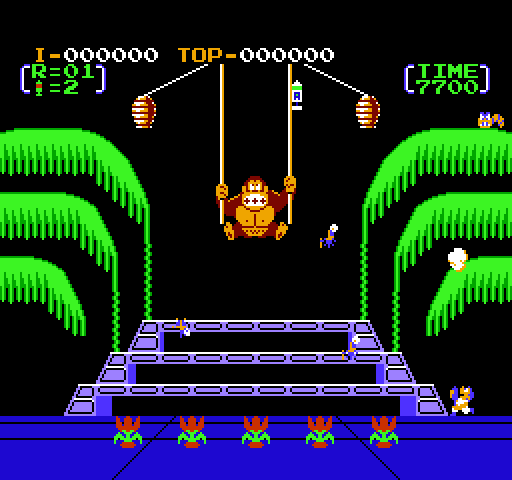
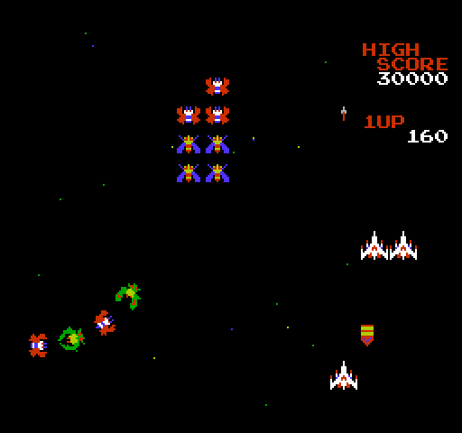
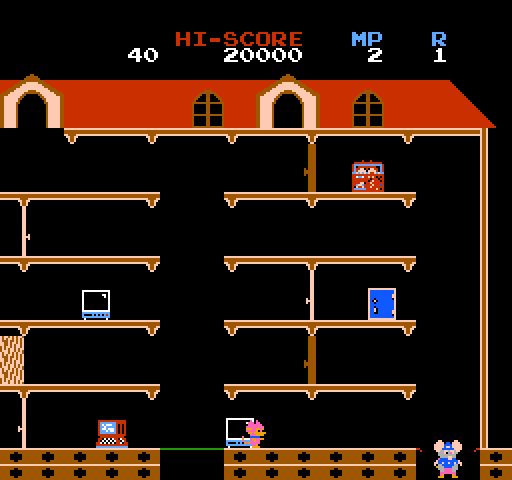
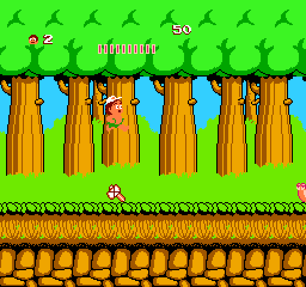
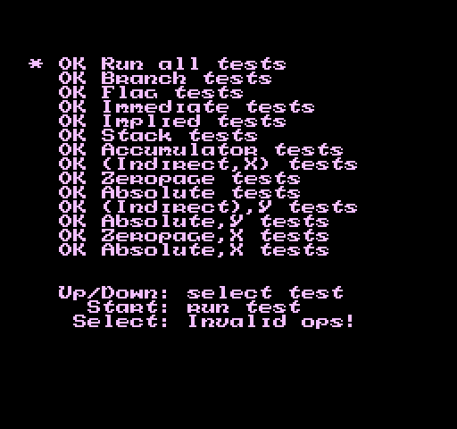
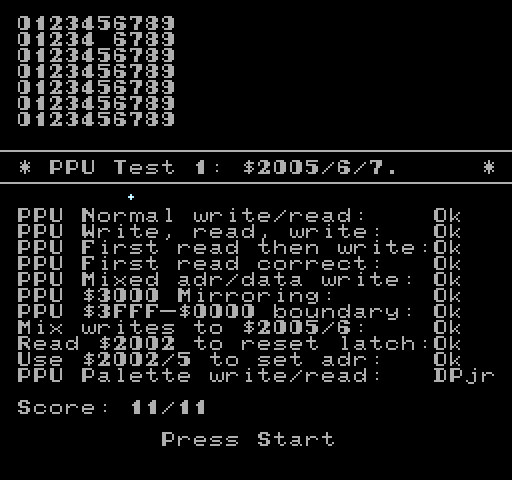

# EMUFAMI v1.1

An educational NES emulator for DOS.

The whole emulator is written using plain, readable Pascal syntax: the 6502, the PPU, the APU and the mappers. Compatible with **TMT Pascal 3.90**, **Free Pascal 3.2** (go32v2) or **Borland Pascal 7.0** (16-bit protected mode). 

This is a work-in-progress project for a fully functional Pascal-based NES emulator running under DOS.

**NOTE:** 
* The owners of **TMT Pascal** has removed the download of TMT Pascal 3.9 for DOS from their website. Good luck finding it, though.
* **Free Pascal for DOS** (go32v2) can be downloaded at: https://www.freepascal.org/down/i386/go32v2.html

**EMUFAMI** supports eight mappers, keyboard control only and Sound Blaster, nothing else.

## Screenshots

| Super Mario Bros. | The Legend of Zelda | Contra |
|---|---|---|
|  |  |  |

| Donkey Kong 3 | Galaga | Mappy |
|---|---|---|
|  |  |  |

| Adventure Island | nestest | NEStress |
|---|---|---|
|  |   |  |

## Running

```
EMUFAMI           Open ROM picker
EMUFAMI ROM.NES   launch ROM.NES
```

### Controls

| ROM picker | |
|---|---|
| Up, Down, PgUp, PgDn, Home, End | choose |
| A-Z | quick jump |
| Enter | open |
| Backspace | parent folder |
| F1| short help |
| F2 | about |
| F3 | sound on/off |
| Esc | quit |

| In-game | Pad 1 | Pad 2 |
|---|---|---|
| D-pad | arrows | W S A D |
| A | X | H |
| B | Z | G |
| Select | Right Shift | T |
| Start | Enter | Y |

**P** pauses, **F1** resets, **F3** turns the sound on or off, and **Esc** closes active ROM.

A game's battery RAM is kept in `NAME.SAV` beside `NAME.NES`. There are no save states.

## System Requirements

- **CPU:** I'm not sure about this. Tested under DOSBox-Stagging and DOSBox-X only.
- **Video:** VGA only, tweaked mode 256x240 @ 60 Hz.
- **Sound:** Sound Blaster (1.x, 2.0, Pro, 16, AWE).
- **Memory:** 4 MB.

## Mappers

| No. | Board | No. | Board |
|---|---|---|---|
| 0 | NROM  | 1 | MMC1 |
| 2 | UxROM | 3 | CNROM |
| 4 | MMC3 | 7 | AxROM |
| 11 | Color Dreams | 66 | GxROM |

Supports NTSC, PAL timings.

## Building

```
BUILD              EMUFAMI.EXE (default to TMT Pascal)
BUILD FPC          EMUFAMI.EXE (Free Pascal - go32v2)
BUILD BP           EMUFAMI.EXE (Borland Pascal 7.0 - protected mode)
```

The BP7 build needs `RTM.EXE` and `DPMI16BI.OVL` (from BP7's `BIN` folder) beside it or on the `PATH`.

Small footprint, TMT-compiled binary is about 80KB, the FPC one is roughly 92KB and the BP7 one about 105KB.

## ROMs

- `nestest.nes`: kevtris's nestest, which checks the CPU's instructions, official and unofficial. Run it, press Start, and read the screen.
- `nestress.nes`: FluBBa's NEStress, with PPU, sound, CPU and controller tests and a stress test of them all.

Both belong to their corresponding owners. No other ROMs included.

## TODOs
- Add support for Borland Pascal.
- More optimizations to improve framerate.
- Support more mappers.

---

(c) 2026 Trinh D.D. Nguyen, Infinity Group.
